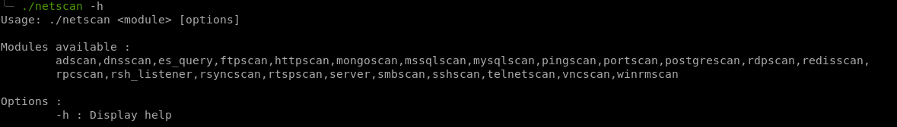
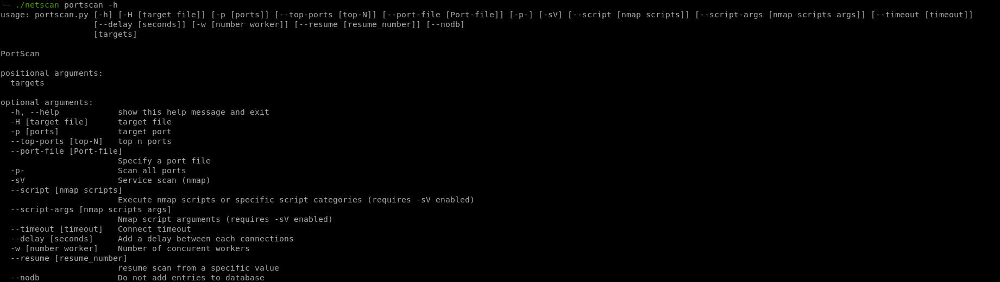
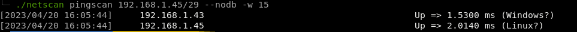
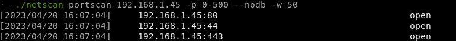
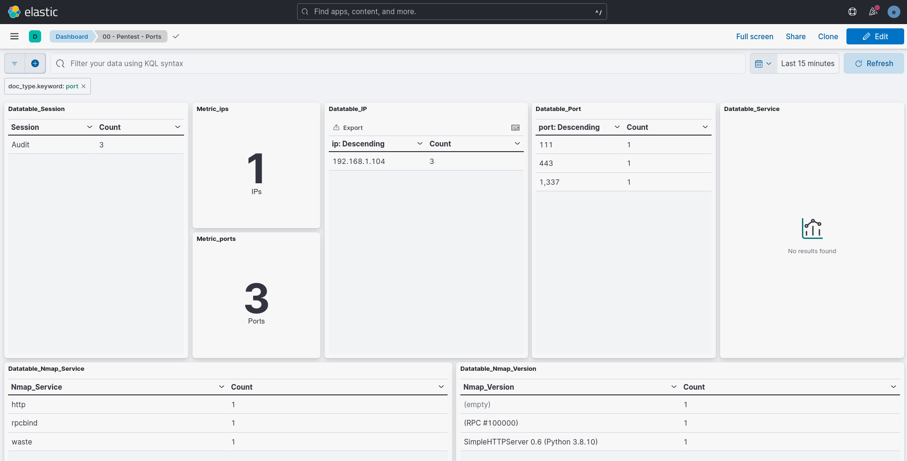
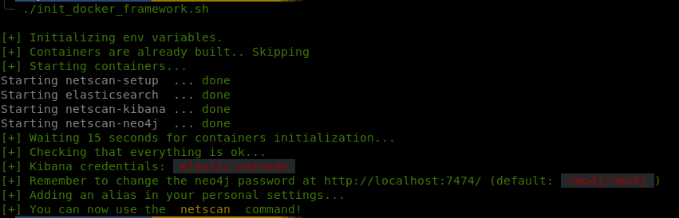

<p align="center">
  
  <br>
  <a href="https://twitter.com/intent/follow?screen_name=hegusung" title="Follow"></a>
  <br>
</p>

# NetScan

> NetScan is a network scanner made for authorized, large-scope pentesting.
> It performs reconnaissance across more than 20 protocols. Results can be stored
> in Elasticsearch and analyzed with the provided Kibana dashboards.
> Scan, Filter, Exploit !

## Features

- [x] Findings can be stored in Elasticsearch and explored in Kibana
- [x] Active Directory
  - [x] Enumeration
  - [x] Active Directory attacks
  - [X] Active Directory modifications
  - [x] Active Directory Certificate Services
  - [x] Bloodhound export
  - [x] Modules
    - [x] ZeroLogon (CVE-2020-1472)
    - [x] NoPAC (CVE-2021-42278 / CVE-2021-42287)
    - [x] Check if ZONE_UPDATE_INSECURE parameter is enabled
    - [x] Check for LDAP signing and channel binding
- [x] Ping scanner
- [x] Port scanner
  - [x] Nmap service detection
  - [x] Nmap scripts executions
- [x] FTP scanner
  - [x] FTP authentication
  - [x] FTP multi-host bruteforce
  - [x] FTP listing
- [x] MySQL scanner
  - [x] MySQL authentication
  - [x] MySQL multi-host bruteforce
  - [x] MySQL database listing
  - [x] MySQL queries
- [x] MsSQL scanner
  - [x] MsSQL authentication
  - [x] MsSQL multi-host bruteforce
  - [x] MsSQL database listing
  - [x] MsSQL queries
  - [x] MsSQL command execution
- [x] MongoDB scanner
  - [x] MongoDB authentication
  - [x] MongoDB multi-host bruteforce
  - [x] MongoDB database listing
- [x] Postgres scanner
  - [x] Postgres authentication
  - [x] Postgres multi-host bruteforce
  - [x] Postgres database listing
  - [x] Postgres command execution
- [x] Redis scanner
  - [x] Redis authentication
  - [x] Redis multi-host bruteforce
  - [x] Redis RCE detection       
- [x] RDP scanner
  - [x] RDP authentication (does not mean you have rdp access)
  - [x] Modules
    - [x] Bluekeep (CVE-2019-0708) detection
- [x] VNC scanner
  - [x] VNC authentication
  - [x] VNC multi-host bruteforce
  - [x] VNC rubber-ducky execution
  - [x] VNC screenshot
- [x] Telnet scanner
  - [x] Telnet authentication
  - [x] Telnet multi-host bruteforce
  - [x] Telnet command execution      
- [x] SSH scanner
  - [x] SSH authentication
  - [x] SSH multi-host bruteforce
  - [x] SSH command execution
  - [x] Modules
    - [x] LinPEAS
    - [x] DirtyPipe (CVE-2022-0847)
    - [x] Get kernel and packages versions
    - [x] List network interfaces
    - [x] PwnKit vulnerability (CVE-2021-4034)
- [x] WinRM scanner
  - [x] WinRM authentication
  - [x] WinRM multi-host bruteforce
  - [x] WinRM password and NTLM authentication
  - [x] WinRM command execution over HTTP or HTTPS
- [x] Rsync scanner
- [x] RTSP scanner
  - [x] Screenshot
- [x] SNMP scanner
  - [x] SNMP authentication
  - [x] SNMP multi-host bruteforce
  - [x] SNMP enumeration
- [X] TLS scanner 
- [X] DNS scanner
  - [x] DNS queries
  - [x] Reverse-DNS queries
  - [x] Subdomain bruteforce
  - [x] AXFR transfer
  - [x] Domain Controller detection
- [x] SMB scanner
  - [x] SMB authentication
  - [x] SMB multi-host bruteforce (be careful not to block accounts...)
  - [x] SMB shared folder listing
  - [x] SMB enumeration
  - [x] SMB secrets collection (SAM, LSA secrets)
  - [x] SMB command execution
  - [x] SMB modules
    - [x] EternalBlue detection (MS17-010)
    - [x] SambaCry detection (CVE-2017-7494)
    - [x] DropTheMic detection (CVE-2019-1040)
    - [x] SMBGhost detection (CVE-2020-0796)
    - [x] PetitPotam exploit (CVE-2021-36942)
    - [x] PrintNightmare vulnerability (CVE-2021-1675)
    - [x] PrintSpooler service detection
    - [x] DFSCoerce
- [x] HTTP scanner
  - [x] HTTP service header and page title enumeration
  - [x] HTTP authentication
  - [x] Directory and file discovery
  - [x] Screenshots with GoWitness
  - [x] Proxy, custom methods, request data, headers and cookies
  - [x] HTTP modules
    - [x] Axis2
    - [x] Tomcat
    - [x] JBoss
    - [x] Heartbleed
    - [x] Jenkins
    - [x] PhpMyAdmin
    - [x] And more !  

## Complete command coverage

The command-line help is the authoritative reference for arguments and defaults:

```bash
./netscan -h
./netscan <command> --help
./netscan <command> --list-modules
```

The last command is available on scanners that support modules. The currently
available top-level commands are:

| Command | Coverage |
| --- | --- |
| `adscan` | Active Directory, LDAP, Kerberos, AD CS and BloodHound collection |
| `dnsscan` | DNS records, reverse DNS, subdomains, AXFR and DC discovery |
| `es_query` | Query and export NetScan results from Elasticsearch |
| `ftpscan` | FTP authentication, listing and credential campaigns |
| `generate_payload` | Generate payloads used by supported execution workflows |
| `httpscan` | HTTP(S) discovery, content discovery, screenshots and modules |
| `jdwpscan` | Java Debug Wire Protocol discovery and command execution |
| `mcpscan` | Discover and inspect MCP endpoints and their exposed tools |
| `mongoscan` | MongoDB authentication, databases and credential campaigns |
| `mssqlscan` | Microsoft SQL Server enumeration, queries and execution |
| `mysqlscan` | MySQL authentication, databases and queries |
| `netscan_mcp_server` | Start the strongly typed NetScan MCP server |
| `pingscan` | Large-scope host discovery |
| `portscan` | TCP scanning, Nmap service detection and NSE scripts |
| `postgrescan` | PostgreSQL enumeration, queries and execution |
| `rdpscan` | RDP authentication and vulnerability modules |
| `redisscan` | Redis authentication, enumeration and RCE checks |
| `rpcscan` | RPC and NFS enumeration, mounts and NFS file operations |
| `rsh_listener` | Start the configured interactive reverse-shell listener |
| `rsyncscan` | Rsync service and module enumeration |
| `rtspscan` | RTSP stream discovery and screenshots |
| `server` | Start configurable HTTP, LDAP and SMB callback servers |
| `smbscan` | SMB enumeration, secrets, execution and vulnerability modules |
| `snmpscan` | SNMPv2/v3 discovery, community campaigns and enumeration |
| `shell` | Open an interactive shell inside NetScan's managed environment |
| `sshscan` | SSH authentication, execution and local-enumeration modules |
| `telnetscan` | Telnet authentication and command execution |
| `tlsscan` | TLS versions, certificates and cipher-suite checks |
| `vncscan` | VNC authentication, screenshots and remote input |
| `whoisscan` | WHOIS lookup and registration data collection |
| `winrmscan` | WinRM password/NTLM authentication and execution |

### Scope-wide credential campaigns

Credential campaigns are supported consistently across FTP, MongoDB, MSSQL,
MySQL, PostgreSQL, RDP, Redis, SMB, SNMP, SSH, Telnet, VNC and WinRM. Depending
on the protocol, campaigns accept usernames, passwords, NTLM hashes or SNMP
communities and can use simple `username=password` attempts or `username:password`
files. Campaign controls include dedicated workers, delay, jitter, round delay,
maximum attempts per account and optional continuation after a success.

Validation results are stored without clear-text secrets. Through MCP, a later
job can reuse an opaque credential ID from Elasticsearch without disclosing the
underlying secret to the agent.

### Nested scanner modules

The runtime module list is available with `--list-modules`. It currently covers:

- Active Directory: NoPac, ZeroLogon, LDAP security and insecure DNS updates.
- HTTP: filesystem/content discovery, headers, secrets, repositories, WebDAV,
  authentication, 403 bypasses and checks for common products such as Tomcat,
  Jenkins, JBoss, WebLogic, GlassFish, Drupal, CouchDB, Elasticsearch and vSphere.
- RDP: BlueKeep detection.
- SMB: MS17-010, SambaCry, DropTheMic, SMBGhost, PetitPotam, DFSCoerce,
  PrintNightmare and Print Spooler checks.
- SSH: LinPEAS, kernel/package/interface enumeration, sudo checks, PwnKit,
  Dirty Pipe and SquashFS-related checks.

Some modules authenticate, modify remote state, upload payloads or execute
commands. Review each command's help and use them only on systems for which you
have explicit authorization.

### Detailed Windows and Active Directory coverage

SMB supports password, NTLM, Kerberos, null-session and guest authentication;
share listing and file search/download; SAM and LSA secret collection; user,
group, administrator, application, process, password-policy, logged-on-user and
session enumeration; RID cycling; and WMI, SMB or MMC command execution,
including PowerShell and generated payload workflows.

Active Directory coverage includes domains, OUs, containers, users, groups,
hosts, DNS, trusts, GPOs, password policies, delegation and RBCD; Kerberoasting
and AS-REP roasting; GPP credentials; ACLs; TGT/TGS operations; AD CS and
certificate templates; LAPS, gMSA and sMSA secrets; NTDS collection; user
credential campaigns; BloodHound export; and explicitly selected directory
modifications.

### Elasticsearch, Kibana and MCP

Unless database output is disabled with `--nodb`, findings are indexed by
session in Elasticsearch. The supplied Kibana saved objects provide views for
ports, services, HTTP content, vulnerabilities, Active Directory, SMB, SNMP,
DNS, credentials, secrets, Nmap scripts and tool logs. `es_query` can search or
export the same data from the CLI.

The MCP server exposes strongly typed tools generated from NetScan's native
`argparse` definitions. It supports local stdio and Streamable HTTP, background
jobs, cancellation, bounded logs, normalized findings, exports and
Elasticsearch session/index handoff. See [MCP server](#3-mcp-server) and the
[MCP server guide](docs/mcp-server.md).


## Screenshots

Display the global help menu


Display a specific module help menu


Run a ping scan to discover devices in the network


Run a port scan to get all opened ports with the nmap options


Display the result in a way-to-cool interface!


## 1. Installation

### 1.0 Automagic installation (with docker)

> Run the following command and enjoy immediately..

```bash
~/netscan$> ./configure_docker.sh
```

The previous command will build and/or start all the framework docker containers used by netscan.
It will create and configure : 
* an elasticsearch container
* a kibana container
* a neo4j container



When everything is up and running, you can use the ` netscan ` command and enjoy.

### 1.1 Manual installation (without Docker)

1. Install dependencies
  ```bash
  $> pip3 install -r requirements.txt
  ```
2. Create the configuration file
  ```bash
  $> cp config.cfg.sample config.cfg
  ```
3. If needed, deploy `Elasticsearch` and `Kibana` on your systema.

## 2. Configuration
> **Note**:  
> The docker version is already configured with default settings. You're good to go.

On your system or in the docker container, 

1. Edit the `config.cfg` file to set the name of your current pentest session under the `[Global]` section.

2. Enable elasticsearch if you want to send all your scan outputs to the database under the `[Elasticsearch]` section.

3. Configure the Kibana dashboards
   
   **Via GUI**  
     > The kibana dashboards are located at [kibana/kibana_dashboards.ndjson](kibana/kibana_dashboards.ndjson).

    - Open kibana at http://127.0.0.1:5601/
    - Go to "Management > Stack Management"
    - Go to "Kibana > Saved Objects"
    - Click on "Import"
    - Select the `kibana_dashboards.ndjson` file provided in this repo
    - Click on "Import"
  
   **Via CLI**  
   ```bash
   $> curl -X POST 'http://127.0.0.1:5601/api/saved_objects/_import?createNewCopies=true' -H "kbn-xsrf: true" --form "file=@$(pwd)/kibana/kibana_dashboards.ndjson"
   ```

  The dashboards should now be available within Kibana


## 3. MCP server

NetScan can be exposed to MCP-compatible clients over local stdio or localhost
Streamable HTTP, including a proxychains-based local setup. It publishes a
strongly typed MCP tool for every NetScan command, generated from the native
`argparse` declarations. Scans run as cancellable background jobs with normalized
findings, bounded output resources, confined downloadable export artifacts, and
an Elasticsearch session/index handoff. Jobs and artifacts survive MCP server
restarts. Thirteen authentication protocols share scope-wide credential campaign
controls, persist secret-free validation results, and can reuse opaque IDs for
credentials stored in Elasticsearch without returning their secrets to the
agent. See the
[MCP server guide](docs/mcp-server.md).

## 4. Troubleshooting

<hr/>

**Problem**: Elasticsearch has not enough memory-mapped areas to run smoothly.  
**Solution** : Run the following command on you system
```bash
sudo sysctl -w vm.max_map_count=262144
```
**Doc**: [https://www.elastic.co/guide/en/elasticsearch/reference/current/_maximum_map_count_check.html](https://www.elastic.co/guide/en/elasticsearch/reference/current/_maximum_map_count_check.html)

<hr/>

**Problem**: Elastic needs at least 10% free space of your hard disk (whatever the disk size). 
**Solution** : You can disable the disk size threshold by running the following commands on you system
```bash
$> curl -X PUT -H "Content-Type: application/json" http://localhost:9200/_cluster/settings -d '{ "transient": { "cluster.routing.allocation.disk.threshold_enabled": false } }'
```

<hr/>
